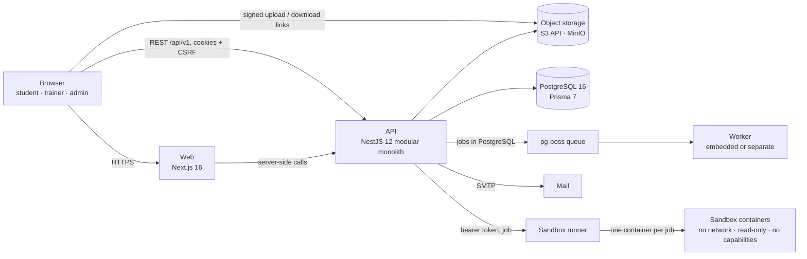

# Architecture overview

| Field  | Value                                                                                                        |
| ------ | ------------------------------------------------------------------------------------------------------------ |
| Status | **CURRENT** — the system as built at commit `74824f5` (2 October 2026), and how `docs/ROADMAP.md` extends it |
| Scope  | The whole platform; the AI layer's target design is in `docs/architecture/AI_ARCHITECTURE.md`                |
| Rule   | Decisions live in ADRs (`docs/adr/`); this page describes and links them, and changes when they change       |

## 1. The system



In staging a Caddy reverse proxy terminates HTTPS in front of the web app, the API and public files
(`infra/Caddyfile`).

Principles that shape every part:

- The browser never reaches the database or the storage directly except through links the API
  signs.
- Learners' code runs only in the sandbox (ADR-0007, ADR-0016). A Web Lab's preview shows the
  learner's page in a sandboxed frame and decides nothing (ADR-0019).
- Every endpoint declares a permission (ADR-0004).
- Every mutation is audited.

## 2. Repository

```
apps/web            Next.js App Router: student, trainer and admin portals; account pages
apps/api            NestJS API: core subsystems + domain modules; Prisma schema, migrations, seeds; CLI
apps/worker         separate worker entry point over the API's job handlers (WORKER_MODE=separate)
apps/runner         sandbox runner: HTTP service that starts one locked-down container per job
packages/shared     Zod schemas and types, permission catalogue, roles, events, theme derivation
packages/ui         design tokens and composites (primitives live in apps/web, ADR-0008)
packages/module-sdk module manifest contract and extension points
packages/config     shared TypeScript and ESLint configuration
clients/<key>       institute configuration: branding, flags, navigation, sample data (SI Academy: clients/demo)
infra               Compose for local services and staging, Caddyfile, the sandbox image (infra/sandbox)
docs                roadmap, product direction, architecture, ADRs, runbooks, progress log, stack pins
```

The monorepo and the modular monolith are ADR-0001; versions are pinned in `docs/STACK.md` (ADR-0002).

## 3. Components

- **Web** (`apps/web`) — Next.js 16 with React 19, Tailwind 4 and shadcn primitives over design
  tokens (ADR-0008, 0013, 0015). Talks to the API through a client generated from its OpenAPI
  document; a strict content security policy (`apps/web/next.config.ts`).
- **API** (`apps/api`) — NestJS 12, a modular monolith. Core subsystems (`src/core`): config, auth
  guards, scope, audit, logging, storage, email, queue, cache, rate limits, HTML sanitising, sheets,
  registry. 25 domain modules (`src/modules`), each with a manifest declaring its permissions, flags
  and navigation (`packages/module-sdk`), plus the execution service. By operating rule 12, modules
  do not import each other's repositories, and cross-module effects go through domain events.
- **Worker** — pg-boss jobs (ADR-0006): email, notifications, imports, exports, reminders, alerts.
  Runs embedded in the API or as `apps/worker`; with `WORKER_MODE=none` handlers run inline (tests).
- **Sandbox runner** (`apps/runner`, ADR-0016) — receives jobs from the API with a bearer token and
  starts one throwaway container per job from the sandbox image. The container has:
  - no network, a read-only root and no capabilities;
  - no new privileges and an unprivileged user;
  - limits on processes, open files, memory and CPU;
  - a wall-clock deadline.

  Results go back to the API, which compares them with the expected output. Expected outputs never
  leave the API. Languages: Java, Python, JavaScript, PHP, SQL on SQLite, and web pages (HTML,
  CSS, JavaScript): a page runs in jsdom and reports only a snapshot, everything it started is
  stopped, and then a separate checker that runs none of its code decides each check (ADR-0019).
  Nothing a case starts outlives it.

- **PostgreSQL 16** through Prisma 7 with versioned migrations; reports read the live tables
  (ADR-0012); enrolment is derived from publication (ADR-0010).
- **Object storage** — the S3 API (`core/storage/s3.driver.ts`, ADR-0005), served by Chainguard's
  build of MinIO (ADR-0017). Public bucket readable anonymously; private bucket only through signed
  links; uploads go straight from the browser to storage on a signed link and are content-checked
  on completion.
- **Email** — SMTP (Mailpit locally) or none.

## 4. Cross-cutting

| Concern        | How it works                                                                                                                                                                     |
| -------------- | -------------------------------------------------------------------------------------------------------------------------------------------------------------------------------- |
| Authentication | own email and password (Argon2id), 15-minute JWT access token, opaque refresh token rotated by family, invitations (ADR-0003)                                                    |
| Authorisation  | `resource:action` permissions with `all` / `batch` / `own` scopes, deny by default, object-level reach in the services (ADR-0004); the defaults per role: `PERMISSION_MATRIX.md` |
| CSRF           | double-submit token on cookie-authenticated mutations                                                                                                                            |
| Validation     | Zod schemas from `packages/shared` at every boundary: HTTP, jobs, imports, environment                                                                                           |
| Errors         | problem+json, no stack traces to clients                                                                                                                                         |
| Audit          | append-only audit log with redaction; personal documents' downloads are audited                                                                                                  |
| Logging        | pino, structured, with redaction                                                                                                                                                 |
| Rate limits    | per route and per account; in-process store (see §7)                                                                                                                             |
| Feature flags  | module flags declared in manifests, set per institute in `clients/<key>/flags.json` and in settings                                                                              |
| Time           | stored in UTC, shown in IST (Asia/Kolkata)                                                                                                                                       |
| Configuration  | environment variables validated at boot; secrets only in the environment                                                                                                         |

## 5. Environments

- **Local** — `pnpm services:up` starts PostgreSQL, MinIO with its buckets and Mailpit
  (`infra/compose.yml`); the API, web and runner run on the host (`docs/runbooks/local-setup.md`).
- **CI** — `.github/workflows/ci.yml` has four jobs:
  - lint, types, unit tests, API tests against PostgreSQL, and builds;
  - real jobs in real containers, plus every reference solution in the question bank;
  - browser journeys on Chromium and an emulated phone, against the built app with a real runner
    and MinIO;
  - images for the API, web, runner and sandbox, pushed to GHCR from `main`.
- **Staging** — one VM with everything in `infra/compose.staging.yml` behind Caddy; deployed only by
  a manual workflow. Never deployed yet. It is Roadmap Phase 14.
- **Production** — not defined yet. The direction is AWS-compatible:
  - containers;
  - managed PostgreSQL, whose AWS offering supports pgvector;
  - S3.

  The choice is an ADR before Phase 14.

## 6. How the roadmap extends the architecture

| Phase | Extension                                                                                                                                                                            |
| ----- | ------------------------------------------------------------------------------------------------------------------------------------------------------------------------------------ |
| 1     | Done: the Labs on the existing runner — the practice module (key kept) with lab types, lab lessons, drafts and the playground (ADR-0018 to ADR-0021)                                 |
| 2     | Done: the learner side completed inside the module contract; a `certificates` module (ADR-0022, pdf-lib); projects as a view over assignments; no new architecture                   |
| 3–4   | Done: staff and operations inside the module contract — course staff (ADR-0023), a `feedback` module, privacy operations and retention; named role-bundle changes (ADR-0009 amended) |
| 5     | Cross-module journeys inside the same module contract; no new architecture expected                                                                                                  |
| 6     | Hardening against the findings in `docs/product/IMPLEMENTATION_ROADMAP.md` §4                                                                                                        |
| 7–11  | An `ai` module behind the same guards, scopes, audit and flags; ingestion as queue jobs; vector storage; orchestration and evaluation (`AI_ARCHITECTURE.md`)                         |
| 12    | Shared stores for rate limits and caches if more than one API instance runs; query and bundle work; renaming the sample-data tooling                                                 |
| 14    | Staging, after the open storage decision in §7                                                                                                                                       |

## 7. Known constraints and open questions

- **Signed links on staging.** Links are signed for the API's own storage address (`http://minio:9000`
  on staging), which browsers cannot reach. This must be decided before Phase 6 closes, and verified
  in Phase 14.
- **Reports read live tables** (ADR-0012). Revisit in Phase 12 with load evidence.
- **One API instance assumed.** Rate-limit counters and caches live in process memory.
- **No vector support yet.** The PostgreSQL image in every environment (`postgres:16-alpine`) has no
  pgvector. ADR-0026 settles it: an Alpine image with pgvector compiled in, prepared in Phase 8A
  (`infra/postgres`) and adopted by every environment together in Phase 8C.
- **amd64 only.** Images are built for amd64.

## 8. Decision record

| ADR  | Decision                                                                     | Status                        |
| ---- | ---------------------------------------------------------------------------- | ----------------------------- |
| 0001 | Monorepo with a modular monolith                                             | accepted                      |
| 0002 | TypeScript stack and version pins                                            | accepted                      |
| 0003 | Own authentication with invitations and rotating refresh tokens              | accepted                      |
| 0004 | Permission-based RBAC with scopes                                            | accepted                      |
| 0005 | Storage, video and email behind drivers                                      | accepted                      |
| 0006 | Queue interface with pg-boss as the default driver                           | accepted                      |
| 0007 | Code execution through an isolated adapter                                   | accepted, amended by ADR-0016 |
| 0008 | UI primitives in the web app; tokens and composites in `packages/ui`         | accepted                      |
| 0009 | Applying default role permissions when a new module ships                    | accepted                      |
| 0010 | Enrolment is derived from publication                                        | accepted                      |
| 0011 | What a browser-run verdict is worth                                          | superseded by ADR-0016        |
| 0012 | Reports read the live tables; one code path serves the page and the file     | accepted                      |
| 0013 | Design system tokens                                                         | accepted                      |
| 0014 | Task 2 learner ecosystem behind flags                                        | accepted                      |
| 0015 | Task 3 visual refinement                                                     | accepted                      |
| 0016 | Learners' code runs in a sandbox runner; the browser never judges it         | accepted                      |
| 0017 | Object storage runs on Chainguard's build of MinIO                           | accepted                      |
| 0018 | Labs are practice questions; the practice module becomes the Labs            | accepted                      |
| 0019 | Web Lab: an isolated preview in the browser, checks in the sandbox           | accepted                      |
| 0020 | SQL Lab: SQLite in the sandbox stays the teaching engine                     | accepted                      |
| 0021 | Playground and lab execution limits                                          | accepted                      |
| 0022 | Certificates of course completion                                            | accepted                      |
| 0023 | Course staff: trainers given authority over a course's content (amends 0009) | accepted                      |

Several ADRs describe their context in the original "demo / white-label template" terms; that is
how the decisions were reached, and the decisions themselves still hold (`docs/ROADMAP.md`).
